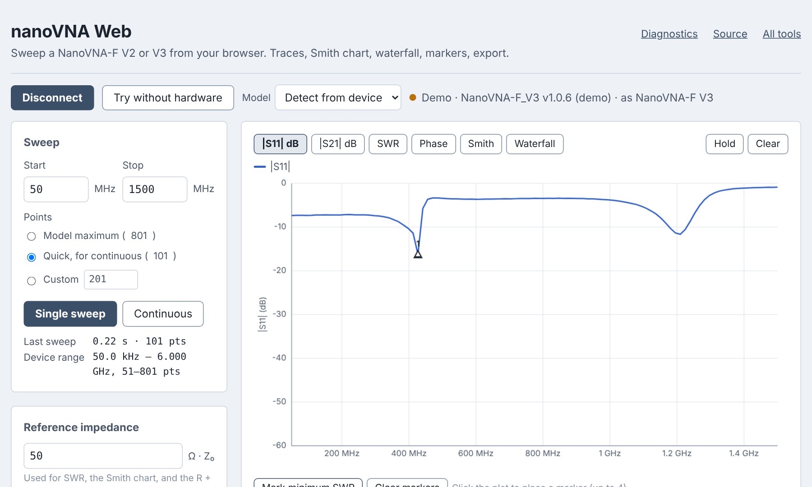

# nanoVNA Web

A browser front end for the NanoVNA-F V2 and F V3. Plug the analyzer in over
USB, open the page in Chrome or Edge, click Connect: S11/S21 traces, SWR, Smith
chart, a live waterfall, markers with an R + jX readout, and CSV / Touchstone
export. Nothing to install.

**Use it:** https://interactive-hardware-interfacing.github.io/nanovna-web/

The page has a *Try without hardware* mode with a simulated F V3, so it can be
previewed anywhere.

<p align="center"></p>

This is the browser companion to the
[nanoVNA_python](https://github.com/LC-Linkous/nanoVNA_python) library: same
command set, same model envelopes, same quirks list, no Python needed.

## Layout

```
┌──────────────────────────────────────────────────────────────┐
│ nanoVNA Web      [Connect] [Demo]  Model ▾   ● status         │
├────────────┬─────────────────────────────────────────────────┤
│ Sweep      │  |S11| |S21| SWR Phase Smith Waterfall CW  Hold │
│  start/stop│                                                 │
│  points    │                    plot                         │
│  [Single]  │              (or the CW meter)                  │
│  [Contin.] │                                                 │
│ ────────── │                                                 │
│ Calibration├─────────────────────────────────────────────────┤
│ ────────── │  Markers  [min SWR] [peak] [send to device]     │
│ Export     │  # freq |S11| SWR R X |S21| phase               │
│ ────────── ├─────────────────────────────────────────────────┤
│ Session &  │  Console ▲ (drag to resize)   Log ▾ [⤓][copy]   │
│  compare   │  > version                                      │
│ ────────── │  NanoVNA-F_V3 v1.0.6                            │
│ Diagnostics│  > scan 50000000 1500000000 801 7               │
│ ────────── │  … 801 lines (1273 ms)                          │
│ Device     │  ┌──────────────────────────────────┐ [Send]    │
│  tools     │  │ type a command                   │           │
│ ────────── │                                                 │
│ Settings   │                                                 │
└────────────┴─────────────────────────────────────────────────┘
```

The sidebar is an accordion — click a header to open it, click again to
collapse; the choice is remembered. Drag its right edge to resize it
(double-click the edge to reset). The markers table sits between the plot and
the console so it has the full width. On narrow screens the sidebar stacks
above the plot.

## What it does (v0.3)

- **Sweep** — start/stop in MHz, points by model maximum / quick / custom,
  single or continuous.
- **Views** — |S11| dB, |S21| dB, SWR, S11 phase, Smith chart, waterfall
  (rolling |S11| history). *Hold* keeps a trace for comparison.
- **Markers** — click to place up to six; each shows frequency, |S11|, SWR,
  R, X, |S21| and phase. *Mark minimum SWR* and *Mark |S11| peak* find them
  for you; *Send first 4 to device* sets the instrument's sweep to match and
  writes the markers to its own four (`sweep`, `marker N idx`); markers 5–6
  stay page-only. A rejection by the device is shown on the markers row.
- **Calibration** — step-through SOLT on the device (`cal open/short/load/
  thru/done`), on/off, reset, save/recall slots, and electrical delay
  (`edelay`). A badge in the top bar shows whether data is corrected.
- **Device readback** — *Use device sweep* copies the instrument's own
  start/stop/points into the page (`sweep`); *Read device data* shows what's
  on its screen without starting a new scan (`frequencies`, `data 0/1`).
- **CW meter** — one frequency, big-number readout of |S11|, SWR, R + jX and
  |S21| updating continuously (`cwfreq` on the device, tiny `scan` for the
  numbers). For trimming an antenna while watching one value.
- **Beep** — the device buzzer (`beep on/off`) after each sweep and/or when
  minimum SWR drops below a threshold you set. Optional browser tone too.
- **Export** — CSV with derived columns, `.s1p`, `.s2p`, plot PNG, and a
  screenshot of the device's own screen.
- **Diagnostics** — one button runs a fixed set of commands, records raw
  replies and timings, and downloads a JSON to attach to an issue. This is
  how the page gets validated against hardware it hasn't seen yet.
- **Console** — the raw serial exchange with a resizable drawer, command
  history (↑ ↓), long replies collapsed, copy button, and a log download
  (commands only, or commands + replies, timestamped).
- **Session & compare** — save/load the whole page state as JSON; load a
  `.s1p`/`.s2p` as a dotted overlay under the live trace.
- **Device tools** — touch calibration, touch test, resolution readback.
- **Settings** — dark (default) or light theme; trace colours as the
  instrument convention (S11 yellow, S21 cyan) or blue/amber; waterfall
  palette (Viridis, Inferno, Turbo, Classic SDR, Grey) and colour floor;
  reference impedance Z₀ (default 50 Ω); beep rules; device screen
  brightness (`pwm`); mirror the page view onto device trace 0 (`trace 0 …`);
  overlay on/off; raw-byte echo for debugging framing. All remembered in the
  browser.

Not yet: group delay, TDR (planned as its own release).

## Supported hardware

Built for the NanoVNA-F V2 and F V3 (what the maintainer owns). The H4 and a
generic envelope are selectable from the Model dropdown but untested. Devices
that use a binary protocol (NanoVNA V2 / SAA-2 family) will not work.

Chrome or Edge is required for the USB link — they implement
[Web Serial](https://developer.mozilla.org/en-US/docs/Web/API/Web_Serial_API).
Firefox and Safari can only use the demo.

## Code layout

No build step; native ES modules.

```
index.html                 markup only
css/
  theme.css                colour tokens: dark/light themes, trace colour schemes
  layout.css               top bar, docked sidebar, plot, console drawer
  components.css           buttons, inputs, tables
js/
  main.js                  app state + wiring
  rf.js                    pure math: dB, SWR, Γ→Z, formatting
  device/                  ← the reusable "library" layer
    shell-link.js          NanoVNA console framing (ch> prompt, echo, binary)
    serial-link.js         Web Serial transport
    demo-link.js           simulated F V3, same byte stream
    models.js              per-model envelopes, detectModel()
    nanovna.js             NanoVNA class — method names mirror nvnapython
  plot/
    rect.js  smith.js  waterfall.js  palettes.js  common.js
  ui/
    sidebar.js  console.js  settings.js  diagnostics.js  export.js
    calibration.js  cw.js  session.js  devicetools.js
```

`js/device/` is the part another tool would reuse: `main.js` calls
`vna.scan(start, stop, pts)` and gets typed arrays back; it never sees `ch>`.

## Running locally

Module scripts don't load from `file://` in Chrome, so serve the folder:

```sh
python -m http.server 8000
# then open http://localhost:8000/
```

Web Serial works on `localhost`, so a real device can be used this way.

## Validating against a real device

1. Connect, run a single sweep. If the plot looks wrong or the sweep fails,
   open *Diagnostics* → **Collect sample** and attach the JSON to an issue
   using the *Scan problem* template.
2. Compare the page's trace with the device's screen (*Export → Device
   screenshot* pulls that over USB too).
3. Export a `.s1p` and open it in anything that reads Touchstone.

## Contributing

See [CONTRIBUTING.md](CONTRIBUTING.md) and the issue templates. Please read
the short [code of conduct](CODE_OF_CONDUCT.md).

## License

GPL-2.0 — see [LICENSE](LICENSE). Same as the nanoVNA_python library.

nanoVNA Web is not affiliated with or endorsed by any NanoVNA manufacturer.
Refer to the manufacturer's documentation for anything about the device itself.
